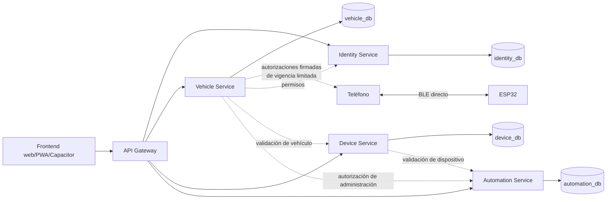

# Arquitectura objetivo del backend de PICHU

**Estado:** arquitectura acordada; documentación únicamente.  
**Alcance:** especificación para una implementación futura. Este documento no implica que existan servicios, modelos, endpoints o infraestructura.

## 1. Arquitectura general

PICHU evolucionará a un monorepo administrado con pnpm. El backend tendrá cuatro microservicios independientes y un API Gateway independiente. Cada uno tendrá proceso, configuración, límites de responsabilidad y ciclo de despliegue propios. Compartir repositorio no implica compartir procesos, responsabilidades, credenciales ni acceso a datos.



### Stack acordado

- **Backend:** Node.js, TypeScript, Fastify.
- **Persistencia:** MongoDB y Mongoose.
- **Entorno local:** Docker Compose.
- **Gestión de paquetes:** pnpm.
- **Frontend existente:** Next.js, React, TypeScript, Tailwind CSS, PWA y Capacitor.

El frontend y el backend conservarán dependencias separadas. El backend no añadirá dependencias de servidor o persistencia al paquete de la aplicación web.

## 2. Servicios y límites de responsabilidad

Cada servicio es dueño de su dominio y de sus colecciones. Ningún servicio puede leer o escribir directamente las colecciones de otro.

| Componente | Datos de los que es propietario | Responsabilidad y límites |
|---|---|---|
| **Identity Service** | `User`, `Session`, `PasswordReset` | Registro, autenticación, sesiones, tokens y recuperación de cuentas. No administra vehículos, membresías ni permisos de módulos. |
| **Vehicle Service** | `Vehicle`, `Membership`, `Invitation`, `AccessGrant` | Vehículos, propietario principal, invitaciones, miembros y permisos de acceso. Es dueño de la autorización por vehículo. |
| **Device Service** | `Device`, `DeviceCredential`, `DeviceRevocation` | Identidad, registro, vinculación, credenciales, revocación y metadatos de dispositivos ESP32. No ejecuta comandos físicos. |
| **Automation Service** | `VehicleModule`, `ModuleConfiguration`, `AutomationRule`, `ReportedState` | Módulos, configuraciones, reglas y estados reportados. El sunroof es el primer módulo previsto. |
| **API Gateway** | Ninguna colección de dominio | Punto de entrada HTTP: enrutamiento, validación inicial, rate limiting, CORS, identificadores de petición y controles comunes. No contiene lógica de dominio ni es dueño de datos. |

El propietario principal de cada vehículo es único. Los invitados tienen permisos limitados; no pueden administrar miembros ni transferir la propiedad. Las operaciones administrativas del propietario deben distinguirse de las acciones concretas autorizadas para cada invitado.

## 3. Modelo conceptual y relaciones

Los siguientes son conceptos y límites de propiedad, no modelos Mongoose ni esquemas implementados.

| Entidad | Servicio propietario | Relaciones conceptuales |
|---|---|---|
| `User` | Identity | Identificador referenciado por propietario, membresías e invitaciones aceptadas. |
| `Session` | Identity | Pertenece a un usuario; mantiene el hash del refresh token rotatorio y su estado de revocación. |
| `PasswordReset` | Identity | Pertenece a un usuario; el token de recuperación es de un solo uso y con caducidad. |
| `Vehicle` | Vehicle | Tiene un `ownerUserId` que referencia a Identity. |
| `Membership` | Vehicle | Relaciona un `vehicleId` con un `userId`, un rol y permisos. |
| `Invitation` | Vehicle | Invita a una identidad a un vehículo; tiene expiración y un estado de aceptación/revocación. |
| `AccessGrant` | Vehicle | Concede permisos concretos para un vehículo, dispositivo o módulo, con vigencia limitada cuando se use para BLE offline. |
| `Device` | Device | Se vincula a un `vehicleId` validado con Vehicle; conserva metadatos e identidad criptográfica del ESP32. |
| `DeviceCredential` | Device | Credencial asociada a un dispositivo; su formato y método de protección se definirán en el diseño de protocolo. |
| `DeviceRevocation` | Device | Marca una identidad o credencial de dispositivo como revocada. |
| `VehicleModule` | Automation | Declara un módulo para un `vehicleId`, por ejemplo el sunroof. |
| `ModuleConfiguration` | Automation | Guarda la configuración deseada de un módulo; no equivale al estado físico actual. |
| `AutomationRule` | Automation | Define una regla asociada al vehículo o módulo y su configuración. |
| `ReportedState` | Automation | Guarda un estado informado por el dispositivo, con su instante de reporte y procedencia. Puede estar obsoleto. |

Las referencias entre servicios son identificadores, no relaciones de base de datos. No se replicarán documentos completos ni se importarán modelos Mongoose de otro servicio.

### Separación de estados

- **Configurado/deseado:** qué módulos o parámetros están habilitados, propiedad de Automation.
- **Reportado/físico:** lo último que el dispositivo informó, propiedad de Automation y acompañado de información temporal que permita identificar datos potencialmente obsoletos.
- Un cambio de configuración no demuestra que el dispositivo lo haya recibido ni que una acción física haya ocurrido.

## 4. API Gateway y comunicación entre servicios

El Gateway es el punto de entrada HTTP del frontend y enruta solicitudes a los servicios. Debe aplicar controles transversales sin sustituir la autorización de dominio. Cada microservicio puede desplegarse individualmente y no debe depender de que el Gateway sea el único control de seguridad.

La comunicación inicial entre servicios será **HTTP interno síncrono**. Por ejemplo, Device validará con Vehicle una asociación de vehículo; Automation validará las referencias necesarias con Device o Vehicle. Cada servicio autentica la identidad de la llamada interna y vuelve a aplicar sus propias reglas de autorización.

Requisitos para esas llamadas:

- Autenticación de servicio a servicio, distinta de confiar en cabeceras enviadas por el cliente.
- Timeouts, límites de reintento y errores explícitos; los reintentos no deben duplicar operaciones.
- Identificadores de petición propagados para correlación y auditoría.
- No realizar llamadas cruzadas a MongoDB ni transacciones distribuidas entre bases de servicios.

No se incorporarán inicialmente Kafka, RabbitMQ ni Redis.

### Evolución a eventos asíncronos

Si una necesidad concreta exige distribuir cambios de forma asíncrona, el servicio propietario podrá emitir eventos de dominio versionados, por ejemplo `MembershipRevoked`, `DeviceRevoked` o `ModuleConfigurationChanged`. Los consumidores deberán tolerar duplicados, mantener idempotencia y tratar los eventos como eventual consistency, no como una transacción global.

Cuando la escritura del dato y la publicación de un evento deban ser consistentes, utilizar **Transactional Outbox**: guardar el cambio de dominio y el evento pendiente en la misma transacción de la base propiedad del servicio; un publicador independiente entrega el evento y marca el outbox. Los consumidores deben ser idempotentes. El broker se escogerá al aprobar esa evolución, no antes.

## 5. Bases de datos

Se utilizará una instancia MongoDB con cuatro bases lógicas:

| Servicio | Base |
|---|---|
| Identity | `identity_db` |
| Vehicle | `vehicle_db` |
| Device | `device_db` |
| Automation | `automation_db` |

Cada servicio será propietario exclusivo de sus colecciones y usará credenciales MongoDB limitadas a su base. Mongoose se utilizará dentro del servicio propietario; no se compartirán conexiones, modelos ni permisos de escritura entre servicios. El entorno local se levantará mediante Docker Compose.

La validación de referencias entre dominios se hace mediante la API del servicio propietario: MongoDB no proporciona una clave foránea transaccional entre estas bases lógicas. La baja o revocación que afecte a varios servicios se propaga mediante llamadas explícitas inicialmente y, si se adopta mensajería en el futuro, mediante eventos con consistencia eventual.

## 6. Seguridad

### Usuarios y sesiones

- Contraseñas con **Argon2id**.
- JWT de acceso de corta duración.
- Todo servicio que acepte JWT verifica firma, emisor (`iss`), audiencia (`aud`) y expiración (`exp`); además valida el sujeto y los permisos necesarios para su recurso.
- Refresh tokens opacos, rotatorios y revocables. Solo se almacena su hash.
- Cookies `HttpOnly`, `Secure` y `SameSite` para los flujos web que correspondan.
- Los secretos en Capacitor se guardarán mediante almacenamiento nativo seguro; no en `localStorage`, cachés PWA ni preferencias sin protección.

### Autorización y protección de servicios

- Autorización por recurso, especialmente por vehículo y módulo; conocer un identificador no otorga acceso.
- Vehicle es la fuente de verdad para propietario, miembros y permisos del vehículo.
- Los servicios tienen credenciales independientes para sus bases de datos y se autentican entre sí.
- Proteger endpoints internos para que no sean accesibles como API pública; verificar identidad de servicio y autorización para cada operación.
- Rate limiting en el Gateway y en endpoints sensibles de servicios; límites apropiados para login, renovación, recuperación e invitaciones.
- Validar entradas en los límites HTTP con esquemas estrictos, límites de tamaño y rechazo de campos inesperados donde corresponda.
- No registrar contraseñas, tokens, secretos de dispositivo ni payloads sensibles. Las operaciones administrativas deben auditar actor, recurso, acción, resultado y hora, sin incluir secretos.

## 7. BLE y autorizaciones offline

El camino de control físico es:

```text
Teléfono → Capacitor → BLE → ESP32
```

El backend administra cuentas, vehículos, permisos y dispositivos; **no participa en cada comando de apertura, cierre o detención**. Por tanto, esos comandos no dependen de Internet ni de la disponibilidad de los servicios.

Para uso offline, el servidor emitirá autorizaciones firmadas, de vigencia limitada, que el ESP32 podrá validar localmente. La autorización deberá quedar acotada al usuario o identidad móvil, vehículo, dispositivo, acciones y periodo autorizados. La implementación requiere un protocolo BLE y firmware diseñados por separado; esta documentación no los implementa.

### Riesgos y requisitos del diseño de protocolo

- **Expiración:** definir duración máxima, tolerancia a desajustes de reloj y política cuando la autorización expira sin conexión.
- **Tiempo confiable:** diseñar cómo se inicializa y mantiene la hora en el ESP32, cómo se detecta un reloj atrasado o retrocedido y qué ocurre tras perder energía. No asumir que el dispositivo siempre tiene Internet o RTC confiable.
- **Reinicios:** definir qué claves, contadores y estado anti-replay persisten; un reinicio no debe restaurar autorizaciones revocadas ni permitir repetir comandos aceptados.
- **Repetición:** incluir nonce, identificador único o contador verificable; el ESP32 necesita guardar de forma persistente el estado mínimo necesario para rechazar autorizaciones/comandos ya utilizados.
- **Identidad criptográfica móvil:** definir cómo se vincula una clave del teléfono a una cuenta y a permisos, cómo se protege en Capacitor, cómo se reemplaza al cambiar de dispositivo y cómo se revoca. No asumir que un JWT web por sí solo demuestra la identidad física del teléfono.
- **Revocación:** una revocación se vuelve efectiva en el ESP32 cuando este sincroniza la información o deja de aceptar una autorización expirada. La revocación inmediata no puede garantizarse mientras el teléfono y el ESP32 no reciban actualizaciones.
- **Vinculación a dispositivo:** el ESP32 debe verificar que la autorización está destinada a su identidad criptográfica y no a otro dispositivo.
- **Separación de autoridad:** la firma debe poder verificarse localmente con una clave pública confiable; los secretos de firma del servidor nunca se distribuyen al teléfono o al ESP32.

La ventana de riesgo offline está limitada por la vigencia de la autorización, no eliminada. Definir su duración y el comportamiento ante tiempo incierto es un requisito previo al protocolo.

## 8. Estructura objetivo del monorepo

La estructura acordada sirve como destino. La aplicación frontend actual vive dentro de `PICHU/` y contiene su propio `package.json`, configuración y documentación; se conservará en su ubicación durante esta etapa. No moverla ni modificarla forma parte de este trabajo. Su posible traslado a `apps/web/` requerirá una migración explícita que preserve Capacitor, PWA y los comandos existentes.

```text
PICHU/                         # raíz del repositorio
├── apps/
│   └── web/                   # destino posible del frontend existente
├── api-gateway/               # servicio desplegable independiente
├── services/
│   ├── identity-service/
│   ├── vehicle-service/
│   ├── device-service/
│   └── automation-service/
├── packages/
│   └── contracts/             # contratos versionados, no modelos Mongoose
├── infrastructure/
│   └── docker/                # futura infraestructura local/operativa
├── docs/
│   └── backend-architecture.md
├── pnpm-workspace.yaml
├── package.json
└── README.md
```

Los límites pueden adaptarse al añadir los proyectos. Los contratos compartidos deben describir interfaces versionadas (DTOs/eventos), no contener acceso a datos ni lógica de dominio. Los paquetes y comandos del frontend seguirán aislados de las dependencias backend.

## 9. Despliegue

Cada microservicio y el API Gateway tendrá su propio proceso y Dockerfile, configuración y ciclo de despliegue. Deberá poder compilarse, ejecutarse y desplegarse individualmente. Docker Compose levantará las dependencias del entorno local, incluida MongoDB; no obliga a desplegar todos los servicios juntos en producción.

Los servicios recibirán configuración y secretos mediante el entorno de ejecución o un gestor de secretos; no se incluirán secretos en el repositorio ni en imágenes. El acceso a MongoDB se limitará por servicio. Cada servicio debe tener health checks y logs estructurados para operación independiente.

No se requiere Kubernetes ni un orquestador complejo. La plataforma de despliegue concreta queda abierta; puede variar por servicio mientras se conserven sus límites, configuración y controles de acceso.

## 10. Decisiones acordadas y clasificación

### Requisitos de esta arquitectura

- Un frontend Next.js/React separado de dependencias del backend.
- Cuatro servicios de dominio y un Gateway con responsabilidades y procesos independientes.
- Fastify, Node.js, TypeScript, MongoDB, Mongoose, Docker y pnpm.
- Cuatro bases lógicas y propiedad exclusiva de colecciones por servicio.
- Sin consultas directas entre datos privados de servicios.
- HTTP interno síncrono inicialmente; sin Kafka, RabbitMQ o Redis en la primera etapa.
- JWT validado por servicio, Argon2id, refresh token opaco/rotatorio/revocable y autorización por recurso.
- Control físico directo por BLE con permisos offline firmados y de vigencia limitada.
- No hacer que las acciones físicas dependan del backend o Internet.

### Convenciones profesionales adoptadas o recomendadas

- Monorepo pnpm para versionar el código y contratos en conjunto, sin acoplar procesos.
- Contratos HTTP/eventos versionados y esquemas de entrada estrictos.
- Timeouts, idempotencia, trazabilidad y health checks.
- Transactional Outbox cuando se incorpore publicación asíncrona que deba ser atómica con una escritura.
- Separar configuración deseada de estado físico reportado y registrar su antigüedad.

## 11. Riesgos y decisiones aún por definir

La arquitectura distribuida aumenta el coste de operación: despliegues múltiples, credenciales, llamadas parciales fallidas, latencia, observabilidad y consistencia eventual. No habrá transacciones globales; cada servicio debe ser tolerante a fallas y dueño de la evolución de sus datos.

Antes de implementar los flujos correspondientes, todavía hay que definir:

1. Duración máxima de autorizaciones BLE, tolerancia de reloj y comportamiento seguro si el tiempo del ESP32 es incierto.
2. Esquema anti-replay persistente y semántica de autorización para cada comando.
3. Enrolamiento, almacenamiento, rotación y revocación de la identidad criptográfica del teléfono y del ESP32.
4. Protocolo de sincronización de revocaciones y ventana offline máxima aceptable.
5. Claims y algoritmos de JWT, gestión/rotación de claves, duraciones exactas y audiencia de cada servicio.
6. Política de invitaciones, transferencia de propiedad, recuperación de cuenta y auditoría/retención.
7. Formato y protección de `DeviceCredential` (por ejemplo, hash o cifrado con claves separadas de MongoDB).
8. Eventos concretos, broker y objetivos de entrega/retención, solo cuando exista una necesidad asíncrona.
9. Versiones soportadas de Node.js, MongoDB, Fastify y Mongoose, y requisitos de backup, recuperación y monitoreo.
10. Plataforma de despliegue y ubicación definitiva del frontend en el monorepo.

Estas decisiones no bloquean la documentación, pero las de BLE, seguridad de claves y despliegue deben resolverse antes de habilitar control físico o producción.
