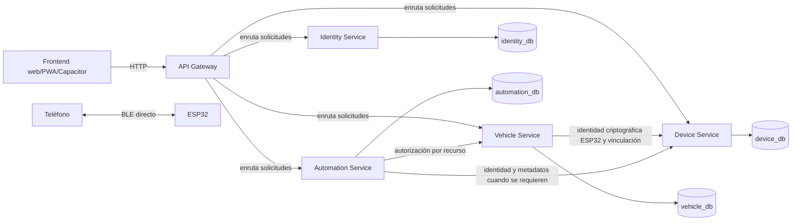

# Arquitectura objetivo del backend de PICHU

**Estado:** arquitectura acordada; documentación únicamente.

**Alcance:** especificación para una implementación futura. Este documento no implica que existan servicios, modelos, endpoints o infraestructura.

## 1. Arquitectura general

PICHU evolucionará a un monorepo administrado con pnpm. El backend tendrá cuatro microservicios independientes y un API Gateway independiente. Cada uno tendrá proceso, configuración, límites de responsabilidad y ciclo de despliegue propios. Compartir repositorio no implica compartir procesos, responsabilidades, credenciales ni acceso a datos.



Las flechas entre servicios representan llamadas HTTP internas autenticadas. Las respuestas vuelven por la misma llamada. El Gateway no forma parte de las llamadas internas. Este flujo no contiene dependencias circulares: Device no llama a Vehicle; Vehicle puede solicitar a Device los datos de identidad del ESP32 y enviarle operaciones de vinculación autorizadas. Automation consulta a Vehicle para autorización por recurso y a Device cuando necesita validar identidad o metadatos del dispositivo.

### Stack acordado

- **Backend:** Node.js, TypeScript, Fastify.
- **Persistencia:** MongoDB y Mongoose.
- **Entorno local:** Docker Compose.
- **Gestión de paquetes:** pnpm.
- **Frontend existente:** Next.js, React, TypeScript, Tailwind CSS, PWA y Capacitor.

El frontend y el backend conservarán dependencias separadas. El backend no añadirá dependencias de servidor o persistencia al paquete de la aplicación web.

## 2. Servicios y límites de responsabilidad

Cada servicio es dueño de su dominio y de sus colecciones. Ningún servicio puede leer o escribir directamente las colecciones de otro.

| Componente | Datos de los que es propietario | Responsabilidad y límites |
|---|---|---|
| **Identity Service** | `User`, `Session`, `PasswordReset` | Registro, autenticación, sesiones, tokens y recuperación de cuentas. No administra vehículos, membresías ni permisos de módulos. |
| **Vehicle Service** | `Vehicle`, `Membership`, `Invitation`, `AccessGrant` | Vehículos, propietario principal, invitaciones, miembros y permisos de acceso. Es dueño de la autorización por vehículo. |
| **Device Service** | `Device`, `DeviceCredential`, `DeviceRevocation` | Identidad, registro, vinculación, credenciales, revocación y metadatos de dispositivos ESP32. No ejecuta comandos físicos. |
| **Automation Service** | `VehicleModule`, `ModuleConfiguration`, `AutomationRule`, `ReportedState` | Módulos, configuraciones, reglas y estados reportados. El sunroof es el primer módulo previsto. |
| **API Gateway** | Ninguna colección de dominio | Punto de entrada HTTP: enrutamiento, validación inicial, rate limiting, CORS, identificadores de petición y controles comunes. No contiene lógica de dominio ni es dueño de datos. |

El propietario principal de cada vehículo es único. Los invitados tienen permisos limitados; no pueden administrar miembros ni transferir la propiedad. Las operaciones administrativas del propietario deben distinguirse de las acciones concretas autorizadas para cada invitado.

Vehicle decide los permisos y es responsable de emitir las autorizaciones BLE offline firmadas. Para vincular una autorización al ESP32 correcto, Vehicle solicita a Device la información de identidad criptográfica del dispositivo. Device es la fuente de verdad de esa identidad y de la vinculación del dispositivo; no decide los permisos de usuario.

## 3. Modelo conceptual y relaciones

Los siguientes son conceptos y límites de propiedad, no modelos Mongoose ni esquemas implementados.

| Entidad | Servicio propietario | Relaciones conceptuales |
|---|---|---|
| `User` | Identity | Identificador referenciado por propietario, membresías e invitaciones aceptadas. |
| `Session` | Identity | Pertenece a un usuario; mantiene el hash del refresh token rotatorio y su estado de revocación. |
| `PasswordReset` | Identity | Pertenece a un usuario; el token de recuperación es de un solo uso y con caducidad. |
| `Vehicle` | Vehicle | Tiene un `ownerUserId` que referencia a Identity. |
| `Membership` | Vehicle | Relaciona un `vehicleId` con un `userId`, un rol y permisos. |
| `Invitation` | Vehicle | Invita a una identidad a un vehículo; tiene expiración y un estado de aceptación/revocación. |
| `AccessGrant` | Vehicle | Concede permisos concretos para un vehículo, dispositivo o módulo, con vigencia limitada cuando se use para BLE offline. |
| `Device` | Device | Se vincula a un `vehicleId` cuya asociación autoriza Vehicle; conserva metadatos e identidad criptográfica del ESP32. Vehicle inicia la vinculación mediante una llamada interna y Device no consulta las colecciones de Vehicle. |
| `DeviceCredential` | Device | Credencial asociada a un dispositivo; su formato y método de protección se definirán en el diseño de protocolo. |
| `DeviceRevocation` | Device | Marca una identidad o credencial de dispositivo como revocada. |
| `VehicleModule` | Automation | Declara un módulo para un `vehicleId`, por ejemplo el sunroof. |
| `ModuleConfiguration` | Automation | Guarda la configuración deseada de un módulo; no equivale al estado físico actual. |
| `AutomationRule` | Automation | Define una regla asociada al vehículo o módulo y su configuración. |
| `ReportedState` | Automation | Guarda un estado informado por el dispositivo, con su instante de reporte y procedencia. Puede estar obsoleto. |

Las referencias entre servicios son identificadores, no relaciones de base de datos. No se replicarán documentos completos ni se importarán modelos Mongoose de otro servicio. El servicio propietario valida sus propios datos y expone la validación necesaria mediante HTTP interno autenticado.

### Separación de estados

- **Configurado/deseado:** qué módulos o parámetros están habilitados, propiedad de Automation.
- **Reportado/físico:** lo último que el dispositivo informó, propiedad de Automation y acompañado de información temporal que permita identificar datos potencialmente obsoletos.
- Un cambio de configuración no demuestra que el dispositivo lo haya recibido ni que una acción física haya ocurrido.

## 4. API Gateway y comunicación entre servicios

El Gateway es el punto de entrada HTTP del frontend y enruta solicitudes a los servicios. Debe aplicar controles transversales sin sustituir la autorización de dominio. Cada microservicio puede desplegarse individualmente y no debe depender de que el Gateway sea el único control de seguridad.

La comunicación inicial entre servicios será **HTTP interno síncrono**. Cada servicio autentica la identidad de la llamada interna y vuelve a aplicar sus propias reglas. Las llamadas siguen una dirección definida para evitar dependencias circulares:

- **Identity** autentica usuarios y emite JWT. Los demás servicios validan la firma, el emisor, la audiencia y la expiración localmente; no llaman a Identity en cada solicitud. La identidad autenticada del sujeto llega en los claims validados. Identity no consulta Vehicle, Device ni Automation.
- **Vehicle** toma decisiones sobre propiedad, membresías y permisos con sus propios datos. Para emitir una autorización BLE o realizar una vinculación, llama a Device para obtener o actualizar la identidad/vinculación del ESP32. Device autentica la identidad de servicio Vehicle y aplica sus reglas sobre dispositivos; no llama de vuelta a Vehicle.
- **Automation** llama a Vehicle cuando necesita autorización vigente para una operación sobre un vehículo o módulo. Llama a Device cuando necesita validar la identidad o metadatos actuales del dispositivo. No consulta sus bases directamente.
- **Device** no decide permisos de usuario ni consulta a Vehicle. Las operaciones de asociación llegan autorizadas desde Vehicle; valida la identidad de servicio llamante y aplica sus reglas de dispositivo.
- **API Gateway** enruta solicitudes externas y aplica controles transversales. No decide permisos de dominio ni es intermediario de las llamadas internas entre servicios.

Las llamadas a los servicios propietarios son necesarias cuando se requiere un dato de dominio vigente que el servicio solicitante no posee, como autorización de vehículo en Vehicle o identidad de ESP32 en Device. La validación criptográfica de un JWT y el uso de claims confiables no requieren una consulta a Identity por solicitud. La operación exacta de invitación que pudiera requerir consultar datos de cuenta a Identity queda pendiente de definir.

Requisitos para esas llamadas:

- Autenticación de servicio a servicio, distinta de confiar en cabeceras enviadas por el cliente.
- Timeouts, límites de reintento y errores explícitos; los reintentos no deben duplicar operaciones.
- Identificadores de petición propagados para correlación y auditoría.
- No realizar llamadas cruzadas a MongoDB ni transacciones distribuidas entre bases de servicios.

No se incorporarán inicialmente Kafka, RabbitMQ ni Redis.

### Evolución a eventos asíncronos

Si una necesidad concreta exige distribuir cambios de forma asíncrona, el servicio propietario podrá emitir eventos de dominio versionados, por ejemplo `MembershipRevoked`, `DeviceRevoked` o `ModuleConfigurationChanged`. Los consumidores deberán tolerar duplicados, mantener idempotencia y tratar los eventos con consistencia eventual, no como una transacción global.

Cuando la escritura del dato y la publicación de un evento deban ser consistentes, utilizar **Transactional Outbox**: guardar el cambio de dominio y el evento pendiente en la misma transacción de la base propiedad del servicio; un publicador independiente entrega el evento y marca el outbox. Los consumidores deben ser idempotentes. El broker se escogerá al aprobar esa evolución, no antes.

## 5. Bases de datos

Se utilizará una instancia MongoDB con cuatro bases lógicas:

| Servicio | Base |
|---|---|
| Identity | `identity_db` |
| Vehicle | `vehicle_db` |
| Device | `device_db` |
| Automation | `automation_db` |

Las cuatro bases lógicas compartirán una única instancia MongoDB en el entorno inicial. Cada servicio será propietario exclusivo de sus colecciones y usará credenciales MongoDB limitadas a su base. Mongoose se utilizará dentro del servicio propietario; no se compartirán conexiones, modelos ni permisos de escritura entre servicios. El entorno local se levantará mediante Docker Compose.

Este aislamiento es lógico y de credenciales, no de disponibilidad: una caída de la instancia compartida afecta a Identity, Vehicle, Device y Automation. La decisión acordada sigue siendo una instancia con cuatro bases lógicas; separar instancias, si alguna vez se requiere, sería una decisión operativa futura.

La validación de referencias entre dominios se hace mediante la API del servicio propietario: MongoDB no proporciona una clave foránea transaccional entre estas bases lógicas. La baja o revocación que afecte a varios servicios se propaga mediante llamadas explícitas inicialmente y, si se adopta mensajería en el futuro, mediante eventos con consistencia eventual.

## 6. Seguridad

### Usuarios y sesiones

- Contraseñas con **Argon2id**.
- JWT de acceso de corta duración.
- Todo servicio que acepte JWT verifica firma, emisor (`iss`), audiencia (`aud`) y expiración (`exp`); además valida el sujeto y los permisos necesarios para su recurso.
- Refresh tokens opacos, rotatorios y revocables. Solo se almacena su hash.
- Cookies `HttpOnly`, `Secure` y `SameSite` para los flujos web que correspondan.
- Los secretos en Capacitor se guardarán mediante almacenamiento nativo seguro; no en `localStorage`, cachés PWA ni preferencias sin protección.

### Autorización y protección de servicios

- Autorización por recurso, especialmente por vehículo y módulo; conocer un identificador no otorga acceso.
- Vehicle es la fuente de verdad para propietario, miembros y permisos del vehículo.
- Los servicios tienen credenciales independientes para sus bases de datos y se autentican entre sí.
- Proteger endpoints internos para que no sean accesibles como API pública; verificar identidad de servicio y autorización para cada operación.
- Rate limiting en el Gateway y en endpoints sensibles de servicios; límites apropiados para login, renovación, recuperación e invitaciones.
- Validar entradas en los límites HTTP con esquemas estrictos, límites de tamaño y rechazo de campos inesperados donde corresponda.
- No registrar contraseñas, tokens, secretos de dispositivo ni payloads sensibles. Las operaciones administrativas deben auditar actor, recurso, acción, resultado y hora, sin incluir secretos.

## 7. BLE y autorizaciones offline

El camino de control físico es:

```text
Teléfono → Capacitor → BLE → ESP32
```

El backend administra cuentas, vehículos, permisos y dispositivos; **no participa en cada comando de apertura, cierre o detención**. Por tanto, esos comandos no dependen de Internet ni de la disponibilidad de los servicios.

Para uso offline, Vehicle decidirá los permisos y emitirá autorizaciones firmadas, de vigencia limitada, que el ESP32 podrá validar localmente. Vehicle consultará a Device para obtener la identidad criptográfica del ESP32 al que vincular la autorización. La autorización deberá quedar vinculada a un usuario o identidad móvil, vehículo, dispositivo, acciones permitidas y periodo de validez.

El ESP32 deberá verificar la firma con una clave pública confiable. El teléfono también deberá demostrar posesión de la clave privada asociada a su identidad criptográfica mediante un mecanismo de desafío-respuesta o equivalente. Una autorización firmada por sí sola puede copiarse a otro teléfono y no autentica criptográficamente al teléfono; por tanto, no sustituye esa prueba de posesión.

Cada comando deberá estar protegido contra repetición. El ESP32 verificará localmente cada comando, comprobará que la autorización aplica y que sigue vigente, y aplicará sus propios límites de seguridad antes de actuar. El diseño detallado del protocolo, el mecanismo criptográfico y el firmware quedan pendientes; esta documentación no los implementa.

### Riesgos y requisitos del diseño de protocolo

- **Expiración:** definir duración máxima, tolerancia a desajustes de reloj y política cuando la autorización expira sin conexión.
- **Tiempo confiable:** diseñar cómo se inicializa y mantiene la hora en el ESP32, cómo se detecta un reloj atrasado o retrocedido y qué ocurre tras perder energía. No asumir que el dispositivo siempre tiene Internet o RTC confiable.
- **Reinicios:** definir qué claves, contadores y estado anti-repetición persisten; un reinicio no debe restaurar autorizaciones revocadas ni permitir repetir comandos aceptados.
- **Repetición:** se exige protección contra repetición, pero el mecanismo concreto queda por diseñar. El ESP32 deberá conservar el estado mínimo necesario para rechazar comandos ya procesados, también después de un reinicio.
- **Identidad criptográfica móvil:** el teléfono debe demostrar posesión de la clave privada asociada a su identidad; definir cómo se vincula esa clave a una cuenta y permisos, cómo se protege en Capacitor, cómo se reemplaza al cambiar de dispositivo y cómo se revoca. Un JWT web por sí solo no demuestra la identidad criptográfica del teléfono.
- **Revocación:** una revocación se vuelve efectiva en el ESP32 cuando este sincroniza la información o deja de aceptar una autorización expirada. La revocación inmediata no puede garantizarse mientras el teléfono y el ESP32 no reciban actualizaciones.
- **Vinculación a dispositivo:** Device proporciona a Vehicle la identidad criptográfica del ESP32. El ESP32 debe verificar que la autorización está destinada a su identidad y no a otro dispositivo.
- **Separación de autoridad:** la firma debe poder verificarse localmente con una clave pública confiable; los secretos de firma del servidor nunca se distribuyen al teléfono o al ESP32. La custodia y distribución de claves públicas confiables aún debe diseñarse.

La ventana de riesgo offline está limitada por la vigencia de la autorización, no eliminada. Definir su duración y el comportamiento ante tiempo incierto es un requisito previo al protocolo.

## 8. Estructura objetivo del monorepo

La estructura objetivo es:

```text
PICHU/
├── apps/
│   ├── web/
│   └── api-gateway/
├── services/
│   ├── identity-service/
│   ├── vehicle-service/
│   ├── device-service/
│   └── automation-service/
├── packages/
│   └── contracts/
├── infrastructure/
│   └── docker/
├── docs/
├── pnpm-workspace.yaml
├── package.json
├── pnpm-lock.yaml
└── README.md
```

En la disposición actual del repositorio, `PICHU/` contiene el frontend y se conserva temporalmente allí, con sus dependencias y configuración independientes. Su traslado a `apps/web/` será una migración posterior y explícita que deberá preservar Next.js, PWA, Capacitor y los comandos actuales.

`apps/api-gateway/` será independiente y desplegable. Los contratos compartidos en `packages/contracts/` describirán interfaces versionadas (DTOs/eventos), no contendrán acceso a datos ni lógica de dominio. La estructura objetivo no implica que esas carpetas o servicios ya existan.

## 9. Despliegue

Cada microservicio y el API Gateway tendrá su propio proceso y Dockerfile, configuración y ciclo de despliegue. Deberá poder compilarse, ejecutarse y desplegarse individualmente. Docker Compose levantará las dependencias del entorno local, incluida MongoDB; no obliga a desplegar todos los servicios juntos en producción.

Los servicios recibirán configuración y secretos mediante el entorno de ejecución o un gestor de secretos; no se incluirán secretos en el repositorio ni en imágenes. El acceso a MongoDB se limitará por servicio. Cada servicio debe tener health checks y logs estructurados para operación independiente.

No se requiere Kubernetes ni un orquestador complejo. La plataforma de despliegue concreta queda abierta; puede variar por servicio mientras se conserven sus límites, configuración y controles de acceso.

## 10. Decisiones acordadas y clasificación

### Requisitos de esta arquitectura

- Un frontend Next.js/React separado de dependencias del backend.
- Cuatro servicios de dominio y un Gateway con responsabilidades y procesos independientes.
- Fastify, Node.js, TypeScript, MongoDB, Mongoose, Docker y pnpm.
- Una instancia MongoDB en el entorno inicial con cuatro bases lógicas y propiedad exclusiva de colecciones por servicio.
- Sin consultas directas entre datos privados de servicios.
- HTTP interno síncrono inicialmente; sin Kafka, RabbitMQ o Redis en la primera etapa.
- JWT validado por servicio, Argon2id, refresh token opaco/rotatorio/revocable y autorización por recurso.
- Control físico directo por BLE con autorizaciones offline firmadas y de vigencia limitada; el ESP32 verifica localmente firma, autorización y límites de seguridad, y los comandos resisten repetición. El teléfono demuestra posesión de su clave privada; una autorización copiable no basta para autenticarlo.
- No hacer que las acciones físicas dependan del backend o Internet.

### Convenciones profesionales adoptadas o recomendadas

- Monorepo pnpm para versionar el código y contratos en conjunto, sin acoplar procesos.
- Contratos HTTP/eventos versionados y esquemas de entrada estrictos.
- Timeouts, idempotencia, trazabilidad y health checks.
- Transactional Outbox cuando se incorpore publicación asíncrona que deba ser atómica con una escritura.
- Separar configuración deseada de estado físico reportado y registrar su antigüedad.

## 11. Riesgos y decisiones aún por definir

La arquitectura distribuida aumenta el coste de operación: despliegues múltiples, credenciales, llamadas parciales fallidas, latencia, observabilidad y consistencia eventual. Además, compartir una instancia MongoDB en el entorno inicial implica un punto común de disponibilidad. No habrá transacciones globales entre servicios; cada servicio debe ser tolerante a fallas y dueño de la evolución de sus datos.

Antes de implementar los flujos correspondientes, todavía hay que definir:

1. Duración máxima de autorizaciones BLE, tolerancia de reloj y comportamiento seguro si el tiempo del ESP32 es incierto.
2. Diseño del desafío-respuesta o mecanismo equivalente para demostrar posesión de la clave privada móvil; formato y vinculación de autorización a usuario, vehículo, dispositivo, acciones y periodo.
3. Mecanismo de protección contra repetición, estado que debe persistir a través de reinicios y límites de seguridad que aplicará el ESP32 a cada comando.
4. Enrolamiento, almacenamiento, rotación y revocación de la identidad criptográfica del teléfono y del ESP32; custodia de la clave firmante de Vehicle y distribución de claves públicas confiables.
5. Protocolo de sincronización de revocaciones y ventana offline máxima aceptable.
6. Claims y algoritmos de JWT, gestión/rotación de claves, duraciones exactas y audiencia de cada servicio.
7. Política de invitaciones, transferencia de propiedad, recuperación de cuenta y auditoría/retención.
8. Formato y protección de `DeviceCredential` (por ejemplo, hash o cifrado con claves separadas de MongoDB).
9. Eventos concretos, broker y objetivos de entrega/retención, solo cuando exista una necesidad asíncrona.
10. Versiones soportadas de Node.js, MongoDB, Fastify y Mongoose, y requisitos de copia de seguridad, recuperación y monitoreo.
11. Plataforma de despliegue y momento de traslado del frontend a `apps/web/`.

Estas decisiones no bloquean la documentación, pero las de BLE, seguridad de claves y despliegue deben resolverse antes de habilitar control físico o producción.
