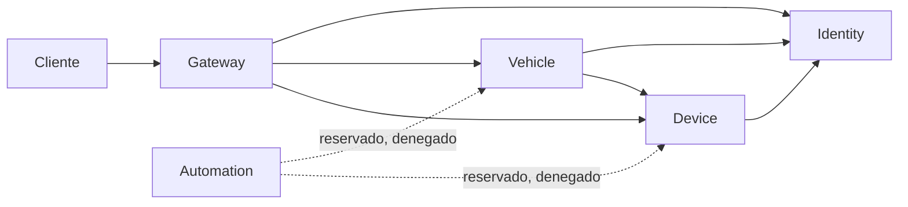

# TKT-009 — Seguridad servicio-a-servicio

Estado: implementación local completada y validada hasta TKT-009.8E. Fecha: 2026-11-13.
No autoriza despliegue ni cambios en infraestructura compartida o productiva.
Los términos DEBE, NO DEBE y PUEDE son normativos.

## Estado de implementación local

Las etapas TKT-009.1 a TKT-009.8E están implementadas en el worktree local: primitivas y
adaptadores `pichu-s2s-v2`, receptores Fastify con autorización por operación, reserva de nonce
persistente mediante `MongoNonceStore`, emisores Gateway/Vehicle/Device, rotación y resiliencia
del transporte, HTTPS nativo y runners aislados de integración.

Se validaron con procesos Fastify reales y MongoDB 8 autenticado en replica set desechable los
saltos Gateway → Vehicle/Device y Vehicle → Identity/Device y Device → Identity. Las pruebas
locales usan CA y certificados efímeros, validación de hostname, HMAC v2, JWT, autorización de
dominio, índices antirreplay y cleanup automático. No existe fallback HMAC v1 activo.

La validación local no equivale a despliegue productivo. Render permanece pendiente de cargar
URLs privadas reales, keyrings por pareja, Secret Files de CA/certificados/claves con SAN
correctos, URIs Atlas separadas, allowlists y smoke tests dentro del entorno desplegado.

## 1. Base inspeccionada y alcance

Rama TKT-009, HEAD `39b8c8f` (integración TKT-008). En Git existen el firmante
`apps/api-gateway/src/security/internal-auth.ts`, proxy y contratos compartidos.
El firmante actual concatena timestamp, request ID, método, URL y hash de
`JSON.stringify(body ?? {})`. No firma identidad del caller, destinatario ni versión.

Los verificadores de Identity, Vehicle y Device, sus modelos antirreplay y los endpoints
internos son cambios locales pendientes, no capacidades confirmadas en HEAD. Usan un secreto
global, ventana de cinco minutos, `service:requestId` como clave de replay y devuelven false
tanto ante duplicado como ante fallo de MongoDB. Vehicle y Device contienen además negocio
local que requiere revisión independiente. Automation local tiene health/docs, sin callers.

Emisores reales: Gateway → Vehicle/Device; Vehicle → Identity/Device; Device → Identity.
Gateway → Identity usa actualmente el proxy de API de usuario. La rotación/revocación local
de Device tiene receptores para Vehicle, pero no un flujo llamante completo aprobado.

Se reutilizarán primitivas de Node, errores públicos, DTOs y reglas de dominio correctas;
no se reutilizará el formato firmado antiguo ni el secreto global. No se modifican APIs
públicas de TKT-008, contraseña 8–256, username obligatorio ni refresh cookie-only.

## 2. Identidades y límites de confianza

Identidades exactas: `api-gateway`, `identity-service`, `vehicle-service`,
`device-service`, `automation-service`. Cada réplica representa a su servicio.
Cada credencial pertenece a `(environment, sender, audience, keyId)`, con claves
independientes para cada pareja dirigida y entorno. Ambientes admitidos inicialmente:
`development`, `test`, `staging`, `production`; nunca hay alias automáticos entre ellos.

Algoritmo único: HMAC-SHA256. El receptor también posee la clave de su conexión, por lo que
no existe atribución criptográfica frente a ese receptor comprometido. Una clave de emisor
compartida con todos sus destinatarios no ofrece el aislamiento aprobado y está prohibida.
Las claves JWT y las claves Ed25519 de ESP32 son identidades y ciclos de vida separados.



## 3. Encabezados y perfil HTTP

Todos los siguientes son obligatorios en una solicitud v2, excepto donde se indica.
Nombres de encabezados insensibles a mayúsculas; valores sensibles a mayúsculas.
Rechazar duplicados mediante `rawHeaders`, antes de aceptar valores combinados por Node.
Rechazar valores con controles, espacios iniciales/finales o listas separadas por comas.
No aplicar trim ni normalizar valores recibidos para hacerlos válidos.

| Encabezado              | Valor exacto o restricción                                                |
| ----------------------- | ------------------------------------------------------------------------- |
| x-internal-auth-version | `2`                                                                       |
| x-service-name          | Identidad exacta del emisor                                               |
| x-service-audience      | Identidad local del receptor                                              |
| x-service-key-id        | `[A-Za-z0-9_-]{1,64}`                                                     |
| x-contract-version      | `v1` inicialmente; independiente de versión criptográfica                 |
| x-timestamp             | Unix ms, `[1-9][0-9]{0,15}`, entero seguro JS                             |
| x-nonce                 | 32 bytes aleatorios; base64url sin padding, exactamente 43 caracteres     |
| x-request-id            | `[A-Za-z0-9_-]{1,128}` para el transporte interno                         |
| x-internal-deadline     | Unix ms con el mismo formato que timestamp                                |
| x-signature             | HMAC de 32 bytes; base64url sin padding, 43 caracteres                    |
| content-type            | Opcional sin body; exactamente `application/json` con body                |
| authorization           | Condicional: `Bearer ` seguido de JWT compacto, sin espacios adicionales  |
| idempotency-key         | Condicional: `[A-Za-z0-9_-]{1,128}` para escrituras que admitan reintento |

Nonce/firma deben decodificar a 32 bytes y recodificar al mismo texto; una regex no basta.
El entorno procede de configuración local, no de una cabecera del caller. `keyId` no es URL,
ruta ni instrucción para consultar un servicio externo.

Máximo 16 KiB de encabezados y 1 MiB de body; cada ruta puede reducir estos límites.
Authorization máximo 8192 bytes. Solo JSON UTF-8 sin BOM, sin Content-Encoding y sin trailers.
GET/HEAD no admiten body. Un body de cero bytes requiere Content-Type ausente; `{}` requiere
Content-Type JSON. La firma no sustituye la validación de JSON/DTOs.

El Gateway descarta `x-service-*`, `x-internal-*`, `x-nonce`, `x-timestamp`, `x-signature`
y `x-contract-version` procedentes de clientes públicos; nunca los copia al transporte interno.
Genera valores nuevos desde contexto verificado. Si el request ID público válido de TKT-008
no satisface el perfil interno ASCII, genera uno interno y conserva la correlación en un
mapeo local de observabilidad; no rechaza por ello la solicitud pública ni cambia su respuesta.
No acepta una idempotency-key pública como autorización para reintentar una escritura.

## 4. Canonicalización exacta

Base de firma: `UTF8(JSON.stringify(fields))`, sin BOM ni salto de línea final.
`fields` es un array de exactamente 16 strings, nunca números, null u objetos:

| Índice | Contenido                                                                    |
| ------ | ---------------------------------------------------------------------------- |
| 0      | `pichu-s2s-v2`                                                               |
| 1      | environment local                                                            |
| 2      | x-service-name                                                               |
| 3      | x-service-audience                                                           |
| 4      | x-service-key-id                                                             |
| 5      | x-contract-version                                                           |
| 6      | x-timestamp                                                                  |
| 7      | x-nonce                                                                      |
| 8      | x-request-id                                                                 |
| 9      | x-internal-deadline                                                          |
| 10     | Método HTTP en mayúsculas, tal como se recibe                                |
| 11     | Request target original: pathname y query, incluyendo `?` si existe          |
| 12     | Content-Type exacto, o string vacío si ausente                               |
| 13     | SHA-256 de bytes originales del body, hexadecimal minúsculo de 64 caracteres |
| 14     | SHA-256 UTF-8 del valor Authorization exacto; hash de cero bytes si ausente  |
| 15     | Idempotency-Key exacto, o string vacío si ausente                            |

Firma: `base64url(HMAC-SHA256(keyBytes, baseBytes))`, sin padding.
Comparar los 32 bytes decodificados con `timingSafeEqual`, después de validar longitudes.
Todos los strings de la base son ASCII; los datos Unicode viajan en JSON del body o query
percent-encoded. No se aplica normalización Unicode ni ordenación de propiedades al body.

El cliente construye la URL final una sola vez y firma el target que efectivamente enviará.
El servidor usa `request.raw.url` antes de rewrite; nunca reconstruye desde `request.query`.
El target debe ser origin-form, comenzar con `/` y medir como máximo 4096 bytes ASCII.
Se prohíben fragmentos, backslash, espacios, controles, `//`, segmentos `.`/`..`, separadores
codificados `%2F`/`%5C` en path y percent-encoding inválido. Los escapes usan hex mayúsculo;
caracteres no reservados deben aparecer literales. No se decodifica dos veces.
Query: pares `nombre=valor`, separados por `&`, nombres no vacíos, sin `+` (espacio es `%20`),
sin separadores vacíos y sin nombres duplicados después de decodificar UTF-8 una vez.
Orden de pares preservado y firmado; cambiarlo cambia la firma. No se admite `?` vacío.
Parámetros desconocidos se rechazan por el DTO de la ruta. No hay semántica de query por `;`.

La configuración resuelve audience a una URL HTTPS fija y certificado confiable; ninguna URL
proviene del payload. `redirect: 'error'`. No se permiten proxies que reescriban target/body
entre firmante y verificador. La autoridad de transporte se valida mediante TLS y configuración;
audience firmado evita reutilizar una petición ante otro servicio.

## 5. Captura del body en Fastify

La futura implementación usará un plugin encapsulado para rutas internas. Reemplazará allí
el parser JSON por `addContentTypeParser` con `parseAs: 'buffer'` y bodyLimit explícito.
Guardará una copia privada del Buffer recibido, sin exponerla al handler ni a logs; devolverá
temporalmente el Buffer como body. En `preValidation`, antes de Zod/AJV y cualquier coerción,
verificará el digest y la autenticación; después decodificará UTF-8 estrictamente y ejecutará
el parser JSON seguro de Fastify, conservando el rechazo de claves de prototype poisoning.
Finalmente asignará el objeto JSON a request.body para validar el contrato de negocio.

El límite cubre el flujo completo: Fastify debe rechazar 413 y longitud inconsistente antes
de entregar el Buffer. No debe haber hooks de descompresión/transformación en preParsing.
El orden de plugins se comprobará con pruebas HTTP reales, también con transferencia chunked.
Los bytes firmados son los del payload después de quitar framing HTTP, no los delimitadores
chunked. Para solicitudes sin payload, inicializar Buffer vacío y verificar incluso cuando
Fastify no invoque el content-type parser. No usar JSON.stringify(request.body) al verificar.
La captura no afecta los parsers de rutas públicas ni incorpora una dependencia nueva.

Referencia de la API: [Fastify Content-Type Parser](https://fastify.dev/docs/latest/Reference/ContentTypeParser/).

## 6. Identidad de usuario y autorización

Autenticación de servicio produce un principal interno inmutable. Cada ruta protegida declara
un operationId estático vinculado a método y plantilla; la ausencia de política deniega acceso.
No se autoriza por prefijo de URL ni por un operationId enviado por el cliente.

Operaciones iniciadas por usuario propagan el JWT original en Authorization, cuyo hash queda
firmado. El receptor valida firma, algoritmo permitido, iss, aud, exp, nbf si existe y sub.
No inventa audiencias nuevas ni acepta tokens solo porque otro servicio ya los validó.
Se conserva la audiencia configurada aprobada de PICHU; no se amplía sin una decisión separada.
userId/inviterUserId de body/query deben corresponder al sub validado cuando representan al
actor; inviteeUserId representa al destinatario de una invitación y no se confunde con el actor.
La validez criptográfica no sustituye controles de sesión/revocación que aplique Identity.

| Emisor → receptor            | Método y ruta / operación                               | Condición                                                           |
| ---------------------------- | ------------------------------------------------------- | ------------------------------------------------------------------- |
| Gateway → Vehicle            | POST /vehicles; GET /vehicles; GET /vehicles/:vehicleId | JWT y permisos de Vehicle                                           |
| Gateway → Vehicle            | POST /vehicles/:vehicleId/invitations                   | JWT actor; Vehicle decide capacidad de invitar                      |
| Gateway → Vehicle            | POST /invitations/:invitationId/accept                  | JWT del destinatario; invitación vigente                            |
| Gateway → Vehicle            | POST /vehicles/:vehicleId/devices/link                  | JWT; propietario o permiso explícito en Vehicle                     |
| Gateway → Device             | GET /devices/:deviceId                                  | JWT y alcance de consulta de Device, estado/revocación              |
| Vehicle → Identity           | GET /internal/users/:userId/exists                      | JWT del actor, puede consultar invitee; devuelve solo exists        |
| Vehicle/Device → Identity    | GET /internal/users/:userId/verified                    | JWT; userId corresponde al actor                                    |
| Vehicle → Device             | POST /internal/devices/register                         | JWT; Vehicle ya autorizó vehículo, Device verifica binding y estado |
| Vehicle → Device             | POST /internal/devices/:deviceId/rotate-key o /revoke   | DENEGADO hasta aprobar flujo y autorización por recurso             |
| Automation → Vehicle/Device  | Operaciones futuras                                     | DENEGADO; sin contratos activos                                     |
| Cualquier otro par/operación | Cualquier ruta                                          | DENEGADO                                                            |

Gateway → Identity conserva las rutas públicas exactas de TKT-008 y sus controles de login,
cookies, Origin y JWT; esas rutas no se convierten en endpoints v2 en TKT-009.1.
No se conceden por ello permisos sobre `/internal/*`. Su transporte también exige TLS.
Health admite solo respuesta mínima en red privada. Documentación interna no se publica.
Los endpoints de desafío/vinculación del ESP32 requieren un protocolo separado aprobado;
no obtienen excepción pública por el mero hecho de no usar HMAC de servicios.

Vehicle conserva propiedad/membresías; Device no consulta colecciones de Vehicle ni llama
de vuelta para autorizar. Autenticar a Vehicle no elimina las comprobaciones de dispositivo.
No se añaden permisos de acciones físicas en esta matriz.

## 7. Tiempo, antirreplay y MongoDB

En la admisión, con N=Date.now(), T=timestamp y D=deadline, exigir simultáneamente:

- `N - 60000 <= T <= N + 5000` (fronteras inclusivas).
- `T < D <= T + 5000` y `N < D`.
- Clave vigente tanto en T como en N: `notBefore <= valor < notAfter`, no revocada.

La hora solo admite tolerancia de cinco segundos hacia el futuro; no se amplía en errores.
Al entrar, convertir presupuesto restante a un reloj monotónico; cambios de hora posteriores
no extienden ejecución. Cada salto conserva D y reduce su timeout al presupuesto restante.
Un request ID identifica la operación correlacionada; el nonce de 32 bytes se genera con
randomBytes en cada intento/salto. Nunca derivarlo del request ID ni del timestamp.

Cada receptor usa `internal_request_nonces` en su propia base, sin accesos cruzados:

```text
environment: string
sender: string
audience: string
nonce: string
acceptedAt: Date
expiresAt: Date(timestamp + 120000)
```

Índice único compuesto `(environment:1, sender:1, audience:1, nonce:1)` y otro índice TTL
simple `(expiresAt:1)` con `expireAfterSeconds:0`. No incluir keyId en la unicidad: rotar
claves no permite reutilizar el nonce. Readiness exige comprobar índices efectivos, no solo
declararlos en Mongoose; su creación será una operación explícita de despliegue.

Después de firma y permiso de servicio válidos, insertar una sola vez con writeConcern
`{w:'majority', j:true, wtimeout:500}` en replica set. Toda reserva no confirmada impide
ejecutar negocio. Duplicate key significa replay; otros errores significan indisponibilidad.
No hacer find-then-insert, upsert que reabra expirados, cache local sustitutiva ni borrar
nonces tras fallos de negocio. Una caída después de reservar consume ese nonce.

La retención de 120 segundos supera la aceptación máxima de 60 segundos, también entre
réplicas con desfase acotado. Requisito operativo: relojes de hosts y MongoDB sincronizados,
error absoluto monitorizado <=5 segundos; desviación detectada saca la réplica de readiness.
Sin esa condición no se garantiza la ventana, y no se habilita tráfico protegido.
El TTL solo limpia; el tiempo se valida en código. Una limpieza tardía solo prolonga el
rechazo. No deducir validez de que exista o falte el documento.
[MongoDB: TTL no elimina inmediatamente](https://www.mongodb.com/docs/manual/core/index-ttl/).

MongoDB indisponible, índice faltante, write timeout o resultado ambiguo: 503, cero efectos
de negocio. Reinicios no eliminan reservas. Nunca reutilizar volúmenes reales en tests.

## 8. Claves, rotación y revocación

Claves de exactamente 32 bytes aleatorios independientes, distribuidas por configuración
segura del despliegue, fuera de Git, imágenes, logs y bases de dominio. Base64url de transporte
debe decodificar canónicamente; HMAC usa bytes, no los caracteres del secreto codificado.
keyId es único y no se reutiliza dentro de pareja/entorno. No derivar claves desde el secreto
global, contraseñas, JWT ni claves de dispositivos.

Keyring local indexado por pareja/keyId, con notBefore/notAfter, estado activo/anterior/revocado.
Una activa para emitir y como máximo una anterior para verificar. Estado de clave no concede
permisos: la matriz se evalúa por separado. Carga/reemplazo de configuración atómico.

Rotación ordinaria propuesta cada 90 días, con solapamiento máximo de 15 minutos:

1. Distribuir nueva clave a todos los receptores y verificar readiness/configuración.
2. Activar emisor; emitir solo con keyId nuevo. No probar claves alternativas tras un 401.
3. Verificar que no quedan emisores antiguos; esperar al menos 65 segundos desde la última
   emisión antigua y retirar esa clave antes del fin de solapamiento.
4. Si no puede cumplirse el plazo, detener tráfico de emisores rezagados; no extenderlo
   silenciosamente. Rollback solo a software compatible con v2 y claves no revocadas.

Compromiso: revocación inmediata sin solapamiento, sacar receptores no actualizados del
tráfico, rotar pareja afectada y registrar incidente. No se puede prometer revocación efectiva
en una réplica que no recibió la configuración y sigue atendiendo: el despliegue debe aislarla.
No limpiar nonces ni reactivar claves comprometidas para restaurar disponibilidad.

## 9. Resiliencia e idempotencia

Presupuesto máximo de cadena: 5000 ms; consulta por intento: 1000 ms; escritura por intento:
2000 ms; MongoDB antirreplay máximo 500 ms, incluido en esos límites. El cliente cancela
conexión, lectura de respuesta y trabajo subordinado al agotarse el presupuesto.
Leer respuesta hasta un máximo de 1 MiB. La cancelación no demuestra que una escritura falló.

Una lectura GET puede tener dos intentos totales, únicamente en el cliente del salto fallido,
ante fallo de red, timeout o 502/503/504. Backoff uniforme aleatorio entero entre 100 y 300 ms.
No reintentar si quedan menos de backoff+1000 ms. Si Retry-After válido exige más espera,
usar ese mínimo solo si cabe; de otro modo terminar. No reintentar 400/401/403/409/429.
No reiniciar toda la cadena ni apilar retries de transporte y aplicación sobre el mismo salto.
Reintento: timestamp y nonce nuevos, mismo request ID y D, nueva firma.

Escrituras: cero reintentos automáticos inicialmente, aunque el cliente envíe idempotency-key.
Solo habilitar reintentos por operación tras implementar reserva única en el servicio dueño,
binding a caller/actor/operación/recurso/hash del body, resultado persistido y actualización
atómica con el cambio de dominio. Misma clave y payload distinto: 409. Estado pendiente o
resultado incierto no autoriza duplicar el efecto. La ventana de deduplicación y recuperación
de cada operación debe aprobarse antes de habilitarla; hoy todas permanecen sin retry.

PROHIBIDO reintentar automáticamente acciones físicas. Una futura idempotencia HTTP no
demuestra ejecución única en ESP32/relé. El control BLE y sus garantías quedan fuera del ticket.

## 10. Errores, red y observabilidad

Sobre `{error,message,requestId}`: 400 para formato inválido sin detalles internos; 401 genérico
para autenticación inválida, replay, clave desconocida/revocada, destinatario o versión no
admitidos; 403 para principal autenticado sin operación; 409 para conflicto de idempotencia;
413/415 para límites/tipo; 503 para seguridad/almacenamiento indisponible; 504 para deadline.
No indicar al caller si la clave existe. Gateway mantiene su contrato público y traduce fallos
de credenciales de servicio a indisponibilidad upstream, no a un supuesto JWT inválido del usuario.
Fallo real de JWT de usuario conserva 401. Esta distinción requiere contexto tipado del error
interno, no heurísticas sobre mensajes de texto.

Auditar operationId, identidad autenticada, keyId, resultado, duración y request ID validado;
no Authorization, firmas, claves, cuerpos, cookies ni URLs con query sensible. No registrar
caller como autenticado antes de verificarlo. Métricas con cardinalidad acotada, rate limiting
por IP antes de autenticación y por caller después, límites de conexiones y payload.

Solo Gateway expuesto públicamente. Listeners de servicios y MongoDB privados, TLS con
validación de certificado y destino, sin redirects. Gateway no tiene proxy wildcard hacia
endpoints internos. Política por ruta protege también rutas como `/vehicles` sin prefijo internal.
Red privada y ACL de pares son controles adicionales del despliegue, no prueba criptográfica.
No se introduce broker, Redis, service mesh ni microservicio nuevo. El Compose actual de
MongoDB no demuestra que los listeners HTTP estén aislados; debe probarse antes de despliegue.

## 11. Migración y despliegue parcial

v2 es incompatible con el formato TKT-008. No se autoriza aceptar ambos protocolos en la misma
entrada ni downgrade automático. Los receptores nuevos se preparan sin habilitar tráfico de
negocio; luego se pausa/drena el flujo de la pareja, se actualizan todos sus receptores y el
emisor a v2, se prueba la pareja y se habilita. Puede usarse una ventana de mantenimiento.
Una réplica antigua no debe quedar detrás del mismo balanceador de rutas v2.

En una mezcla accidental: emisor antiguo → receptor v2 falla; emisor v2 → receptor antiguo
no se considera compatible ni listo. Readiness/despliegue deben impedir ese tráfico, sin
relajar autenticación para conseguir disponibilidad. El secreto global no se distribuye a
receptores nuevos. Conservar el código antiguo en Git no autoriza su activación.

Orden: Identity receptor; Vehicle/Device receptores y callers; Gateway emisor; prueba end-to-end.
Activación de negocio solo cuando toda su cadena esté lista. Automation continúa denegado.
No copiar implementaciones locales de Vehicle/Device sin aprobar su base y pruebas de dominio.

Propuesta de cambio posterior, NO aplicada: añadir schemas v2 de headers/canonical primitives
a `packages/contracts/src/internal.ts`, manteniendo los exports v1 durante la transición de
compilación. No confundir coexistencia de tipos con aceptación de v1 en ejecución. Impacta
callers, validadores, fixtures y OpenAPI internos; no cambia los DTOs públicos ni su versión v1.
Requiere aprobación adicional antes de modificar contratos. La lógica criptográfica compartida
se ubicará fuera de contracts; su ubicación concreta se aprobará en TKT-009.2.

## 12. Vectores reproducibles

Material completamente sintético, prohibido como credencial real. Key bytes = hex
`000102030405060708090a0b0c0d0e0f101112131415161718191a1b1c1d1e1f`.
Nonce bytes iguales a esa secuencia SOLO en estos vectores. En producción son independientes.
Sin Authorization ni Idempotency-Key. POST /vehicles, entorno test, emisor api-gateway,
destinatario vehicle-service, keyId test-key-01, contrato v1, request ID vector-001,
T=1800000000000 y D=1800000005000. Sin newline en bodies.

| Vector | Body UTF-8           | Content-Type     | Firma base64url esperada                      |
| ------ | -------------------- | ---------------- | --------------------------------------------- |
| V0     | Cero bytes           | Ausente          | `9rTt3dTH_BQ6BDIHrZtVi7v9HRveThWegr1iz92yNM0` |
| V1     | `{}`                 | application/json | `XDN4R6XxeyY-FfF3-xmMa2sgx60Jd8VPfR6F1NTWFSI` |
| V2     | `{"name":"Mazda 3"}` | application/json | `JEjn5CL-9-A2hG-ajE8t7RfkW_2WT17Sc8WOifL_aK0` |

Son vectores criptográficos, no registros válidos de negocio ni JWT. Evaluarlos por separado;
si se envían juntos reutilizan nonce y deben rechazarse como replay después del primero.
Para pruebas de admisión, fijar N=T y clave vigente. El reloj real no acepta estos timestamps.

Ejecutar este bloque con Node.js 24 (por stdin o en archivo temporal de pruebas). Imprime la
base exacta y comprueba resultados constantes; no accede al entorno, red ni bases de datos:

```javascript
const assert = require('node:assert/strict');
const { createHash, createHmac } = require('node:crypto');
const key = Buffer.from(Array.from({ length: 32 }, (_, i) => i));
const sha = (value) => createHash('sha256').update(value).digest('hex');
const cases = [
  ['', '9rTt3dTH_BQ6BDIHrZtVi7v9HRveThWegr1iz92yNM0'],
  ['{}', 'XDN4R6XxeyY-FfF3-xmMa2sgx60Jd8VPfR6F1NTWFSI'],
  ['{"name":"Mazda 3"}', 'JEjn5CL-9-A2hG-ajE8t7RfkW_2WT17Sc8WOifL_aK0'],
];
for (const [body, expected] of cases) {
  const fields = [
    'pichu-s2s-v2',
    'test',
    'api-gateway',
    'vehicle-service',
    'test-key-01',
    'v1',
    '1800000000000',
    key.toString('base64url'),
    'vector-001',
    '1800000005000',
    'POST',
    '/vehicles',
    body ? 'application/json' : '',
    sha(Buffer.from(body, 'utf8')),
    sha(Buffer.alloc(0)),
    '',
  ];
  const base = JSON.stringify(fields);
  const actual = createHmac('sha256', key).update(base, 'utf8').digest('base64url');
  assert.equal(actual, expected);
  for (const position of [1, 2, 3, 4, 5, 6, 7, 8, 9, 10, 11, 12, 13, 14, 15]) {
    const changed = [...fields];
    changed[position] += 'x';
    assert.notEqual(
      createHmac('sha256', key).update(JSON.stringify(changed)).digest('base64url'),
      expected,
    );
  }
  console.log(JSON.stringify({ body, base, signature: actual }));
}
console.log('VECTORS_PASS: 3 positive, 45 mutations');
```

Casos normativos adicionales para TKT-009.2: cambiar espacio/orden de propiedades del body
con firma vieja → rechazo; cambiar query u orden con firma vieja → rechazo; cambiar bearer
→ rechazo; duplicar headers/nonce/firma no canónica → rechazo; claves de otra pareja/entorno
→ rechazo. N=T+60000 cumple frescura pero D ya expiró: rechazo por deadline; N=T-5000 cumple
frescura, N=T-5001 falla; N=D falla. Expiración de clave es exclusiva en notAfter.

## 13. Aceptación, pruebas y siguientes etapas

TKT-009.1 quedó completado como especificación normativa; las etapas posteriores implementaron
y validaron localmente el protocolo. El cierre técnico local no equivale a despliegue seguro ni
autoriza activar la configuración en Render, Atlas u otro entorno compartido.

Para TKT-009 completo se exigirán pruebas unitarias de canonicalización, parsing y límites;
HTTP real Fastify para body original, chunked, encabezados duplicados y plugins; matriz positiva
y negativa por operación; JWT inválido y discrepancia de actor; redirecciones, timeouts y retries;
rotación normal, revocación urgente y despliegue mixto con denegación segura.

MongoDB real: replica set desechable separado del entorno de desarrollo, credenciales de test,
lista explícita de bases permitidas y prohibición de cargar .env reales. Validar índices,
inserciones concurrentes desde dos réplicas (una sola alcanza negocio), reinicio, cambio de
primario, write timeout ambiguo, TTL tardío y caída de MongoDB sin efectos de dominio.
Pruebas de despliegue deben demostrar que Internet no alcanza listeners internos y que ningún
caller autenticado obtiene permisos fuera de su fila. Acciones físicas no se ejecutan.

Etapas siguientes, cada una con aprobación y snapshot reproducible:

1. TKT-009.2: contratos v2 aprobados, primitivas y vectores; sin negocio ni MongoDB compartido.
2. Adaptadores Fastify y almacenamiento antirreplay por servicio; pruebas HTTP/MongoDB.
3. Integración Identity, Vehicle, Device y Gateway por parejas, sin incorporar negocio ajeno.
4. Rotación, aislamiento y pruebas de despliegue parcial; documentación operacional.

Pendientes operacionales que bloquean despliegue, no la definición del protocolo: plataforma
TLS/ACL, distribución efectiva de secretos, inventario de réplicas y sincronización de reloj;
aprobación de base de negocio local Vehicle/Device; flujos de rotación/revocación de dispositivo
y operaciones de Automation (siguen denegados); idempotencia específica (sin retries de escritura).
Pendiente de aprobación adicional: ubicación de biblioteca compartida y cambios de contracts.
